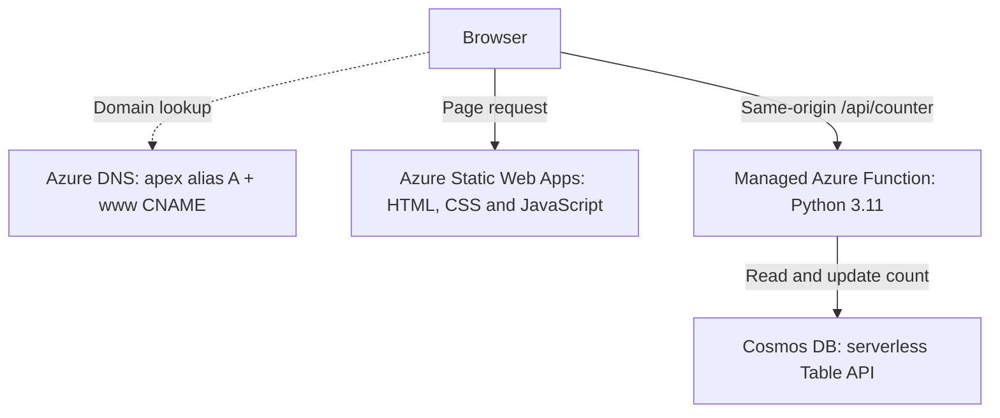

# Cloud Resume

My resume, with a terminal-style interface and some actual cloud infrastructure behind it. Built for the [Cloud Resume Challenge on Azure](https://cloudresumechallenge.dev/docs/the-challenge/azure/) and to get more hands-on with Terraform, serverless services, and CI/CD.

The site is live at **[glasscliff.online](https://glasscliff.online)**. My earlier portfolio and working labs live at **[projects.glasscliff.online](https://projects.glasscliff.online)**, which is also linked from the resume.

The page has a visitor counter backed by a Python API and Cosmos DB. Terraform defines the cloud infrastructure, and GitHub Actions tests and deploys changes to the site and API.

## Architecture



- **Frontend:** One HTML page in `site/`, with its CSS and JavaScript. No framework or build step.
- **API:** A Python Azure Function using the v2 programming model at `/api/counter`. It reads or increments the visitor count and returns `{"count": n}`. Static Web Apps serves it from the same origin as the page, so there's no separate CORS setup.
- **Database:** Cosmos DB using the Table API in serverless mode. It stores a single counter record, keeping the workload small and the cost low at this traffic level.
- **DNS and TLS:** Azure DNS hosts the zone, with an alias A record for the apex domain and a CNAME for `www`. Static Web Apps handles certificate issuance and renewal for both.
- **Infrastructure:** Terraform with `azurerm` 4.x. State lives in Azure Storage, with Entra ID authentication instead of storage account keys.

## Repository layout

| Path | What's in it |
| --- | --- |
| `site/` | Resume page, assets, and `staticwebapp.config.json` for routing, headers, and the API runtime |
| `api/` | Azure Function, `host.json`, and runtime dependencies |
| `tests/` | Counter unit tests using pytest |
| `infra/` | Terraform for the resource group, Static Web App, custom domains, DNS records, and Cosmos DB |
| `.github/workflows/site.yml` | Site and API test/deployment workflow |
| `.github/workflows/infra.yml` | Terraform format/validate/plan, and apply on `main`, signed in to Azure over OIDC |

## CI/CD

There are two workflows, split by what changed.

**`site.yml`** runs on pushes to `main` and pull requests that change `site/`, `api/`, `tests/`, or the workflow itself.

1. **Test:** Set up Python 3.11, install the dependencies, and run pytest.
2. **Deploy:** After the tests pass on `main`, upload the site and API to Static Web Apps.

Pull requests run the tests without deploying. The deployment job uses `needs: test`, so a failed test blocks the release. That doesn't catch every possible bug, but it keeps a known failing build from being deployed through this workflow.

**`infra.yml`** runs on changes to `infra/`.

1. **Plan:** `terraform fmt -check`, `init`, `validate` and `plan`.
2. **Apply:** On a push to `main`, `terraform apply`.

### Credentials

- **Terraform** signs in to Azure with OIDC federation (`ARM_USE_OIDC`, `id-token: write`). GitHub holds only the client, tenant and subscription IDs, none of which are secrets, so no Azure credential is stored for infrastructure changes.
- **The site upload** uses the Static Web Apps deployment token in the `AZURE_STATIC_WEB_APPS_API_TOKEN` repository secret. The deploy action authenticates with that token rather than an Azure sign-in.
- **The API** reads a Cosmos DB connection string from the `COSMOS_CONNECTION` app setting. Terraform builds it from the account key, so the key is also present in Terraform state, which is one reason state lives in Azure Storage with Entra ID authentication rather than account keys.

## Run the tests locally

From the repository root:

```powershell
py -3.11 -m venv .venv
.venv\Scripts\Activate.ps1
python -m pip install -r requirements-dev.txt
python -m pytest -q
```

The tests mock the table client, so you don't need Azure credentials to run them. The counter logic is separate from the Azure Functions entry point, which also means the tests don't need the Functions runtime.

## Deploy the infrastructure

With Azure authentication configured, set the subscription ID before running Terraform. This is required by `azurerm` 4.x.

```powershell
$env:ARM_SUBSCRIPTION_ID = "<subscription-id>"
cd infra
terraform init
terraform plan -out tfplan
terraform apply tfplan
```

The variables are defined in `infra/variables.tf`. `infra/terraform.tfvars` is committed on purpose: it holds only non-secret values (domain, DNS zone and its resource group), and the `infra` workflow reads it during `plan` and `apply`. Anything sensitive belongs in an untracked `*.local.tfvars` file, which `.gitignore` excludes.

Terraform exposes the Static Web Apps deployment token as a sensitive output. The workflow uses it through the `AZURE_STATIC_WEB_APPS_API_TOKEN` repository secret.

## Why I built it this way

- **Static Web Apps:** It gives me hosting, custom domains, TLS, and a same-origin API on the free tier. I considered Storage with a CDN or Front Door and a separate Function App, but that added components and cost I didn't need for this site.
- **Table API:** The database holds one counter record. The Table API fits that job without needing a more involved data model.
- **Terraform:** I wanted the infrastructure to be something I could recreate and review in code, with changes tracked alongside the application. The DNS zone and the state storage account existed before this project, so Terraform reads the zone as a data source and doesn't manage either.
- **Apply without an approval gate:** `infra.yml` applies on every push to `main`. For a one-person site with a reviewed plan in the pull request that's an accepted risk; on a shared repo I'd put `apply` behind a GitHub environment with a required reviewer.

## Write-up

[Blog](https://glasscliff.online/blog.html)

## Author

Antalon Jackson Jr. — [glasscliff.online](https://glasscliff.online)
